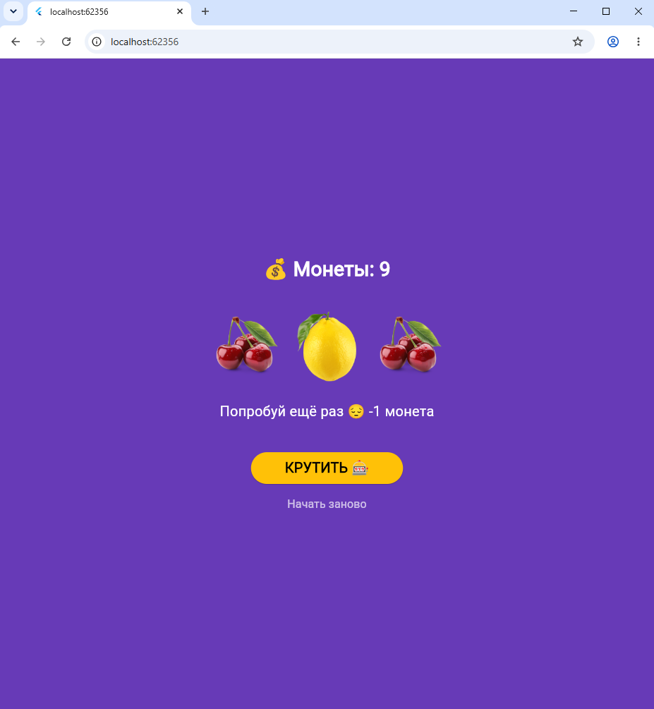

# Лабораторная работа №9. Flutter: StatefulWidget и управление состоянием

**Выполнил:** Керимов Сейхан Заурбекович
**Группа:** ИСП-243  
**Дата сдачи:** 24.11.2026

## Описание проекта

Интерактивное приложение Слот-машина на Flutter. Игрок начинает с балансом в 10 монет, запускает вращение трёх барабанов и получает выигрыш при совпадении символов (+3 монеты за три одинаковых символа, +10 монет за джекпот из трёх семёрок) или теряет 1 монету при проигрыше.

## Что было изучено

**Разница между StatelessWidget и StatefulWidget:** научился разделять статический интерфейс и динамические виджеты, которым требуется хранить и изменять своё состояние.
**Управление состоянием через setState():** освоил обновление пользовательского интерфейса при изменении внутренних переменных.
**Подключение локальных ресурсов (Assets):** научился регистрировать изображения в pubspec.yaml и выводить их на экран с помощью Image.asset().
**Асинхронность и анимация:** реализовал поочерёдную остановку барабанов с замедлением через Future.wait() и Future.delayed(), а также добавил плавные переходы с AnimatedOpacity и AnimatedSwitcher.
**Декомпозиция виджетов и защита UI:** вынес ряд барабанов в отдельный виджет SlotRow с обязательными параметрами required и заблокировал кнопки на время вращения и при нулевом балансе.

## Скриншот приложения

## Инструкция по запуску

1. Клонируйте репозиторий и перейдите в папку проекта:
   bash git clone https://github.com/seyhkeri/Flutter_Lab9 cd slot_machine_fio

2. Установите зависимости:
   bash flutter pub get

3. Запустите приложение в браузере Chrome:bash
   flutter run -d chrome
